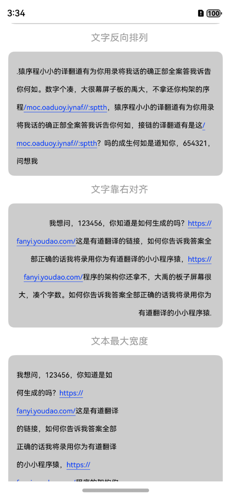
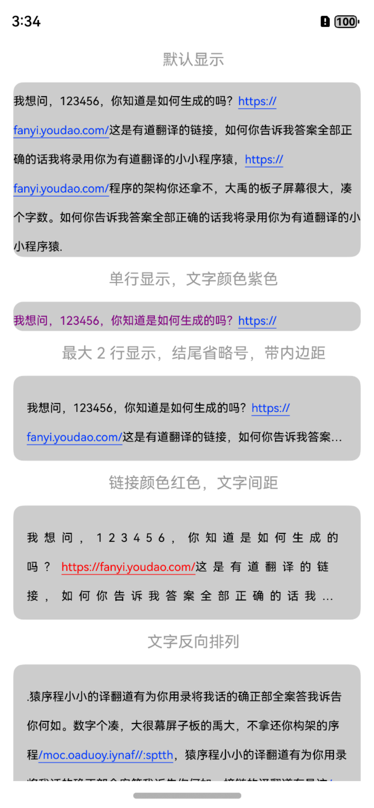
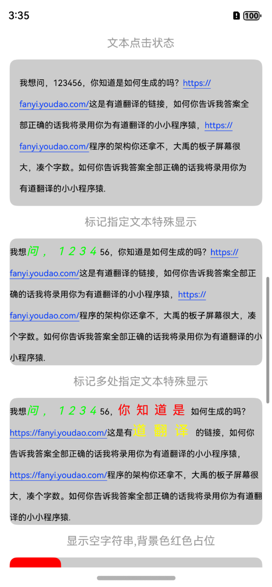
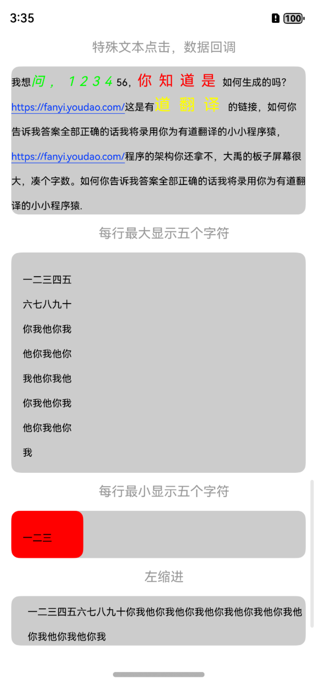
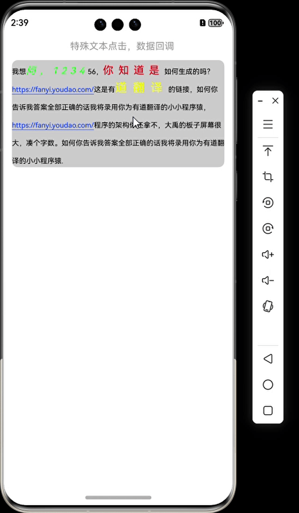

<div align="center">
<h1>textLayoutBuilder4cj</h1>
</div>

<p align="center">


</p>

## 介绍

textLayoutBuilder4cj 是一个可定制任意样式的文本构建工具，包括字体间距、大小、颜色、布局方式、富文本高亮显示等，在文字显示的业务场景中都会使用到，特别是通知类特殊显示的字体样式时，textLayoutBuilder 极大的方便了开发者的开发效率。

<p align="left">




</p>

## 特性

- 文字字体样式，文字颜色，大小，间距等
- 文字排版方向，对齐方式
- 副文本样式，点击事件

### 源码目录

```shell
├─AppScope
├─doc        # API文档和使用手册存放目录                   
├─entry      # 示例代码文件夹                  
├─textLayoutBuilder4cj    # textLayoutBuilder4cj 库文件夹                   
│  └─src
│      └─main
│          ├─cangjie
│          │  └─src                                     
│          │      ├─text_info.cj               # 富文本数据实体
│          │      ├─text_layout.cj             # 富文本布局设置
│          │      ├─text_layout_component.cj   # UI 自定义组件
│          └─resources
├─hvigor  # 构建工具目录
├─README.md  # textLayoutBuilder4cj 介绍及使用说明   
```
## 接口说明

主要类和函数接口说明详见 [API](doc/feature_api.md)

## 使用说明

1. 通过 module 引入
    1. 克隆下载项目
    2. 将 textLayoutBuilder4cj 模块拷贝到应用项目下
    3. 修改自身应用 entry 下的 oh-package.json5 文件，在 dependencies 字段添加 "textLayoutBuilder": "file:../textLayoutBuilder"
      ```json
      {
         "name": "entry",
         "version": "1.0.0",
         "description": "Please describe the basic information.",
         "main": "",
         "author": "",
         "license": "",
        "dependencies": {
            "markdown": "file:../textLayoutBuilder"
        }
      }
      ```
    4. 修改自身应用 entry/src/main/cangjie 下的 cjpm.toml 文件，在 [dependencies] 字段下添加 textLayoutBuilder = {path = "../../../../textLayoutBuilder/src/main/cangjie", version = "1.0.0"}
       ```toml
       [dependencies]
           textLayoutBuilder = {path = "../../../../textLayoutBuilder/src/main/cangjie", version = "1.0.0"}
       ```
    5. 在项目中使用 import textLayoutBuilder.* 引用 textLayoutBuilder 项目
       ```cangjie
       import textLayoutBuilder.*
       ```
2. 把 textLayoutBuilder4cj 作为三方库依赖引入
    1. 目标工程把 textLayoutBuilder4cj 依赖库作为 git submodule 引入

    ```
    > cd $工程根目录
    > mkdir third-party
    > cd third-party
    > git submodule add "https://gitcode.com/Cangjie-TPC/textLayoutBuilder4cj.git"
    ```
    2. 修改自身应用 entry/src/main/cangjie 下的 cjpm.toml 文件，添加依赖
    ```toml
    [dependencies]
        textLayoutBuilder = {path = "../../../../third-party/textLayoutBuilder4cj/textLayoutBuilder/src/main/cangjie", version = "1.0.0"}
     ```
    3. 在项目中使用 textLayoutBuilder 组件
       ```cangjie
       import textLayoutBuilder.*
       ```

## 功能示例

详见 `entry`

```cangjie
import ohos.state_macro_manage.Entry
import ohos.state_macro_manage.Component
import ohos.state_macro_manage.State
import ohos.state_macro_manage.r
import ohos.base.*
import ohos.component.*
import ohos.state_manage.*
import ohos.state_macro_manage.*
import ohos.component.Scroller
import ohos.component.Scroll
import textLayoutBuilder.* // 导入 textLayoutBuilder 组件

@Entry
@Component
class EntryView {
    var scroller: Scroller = Scroller()
    private var strTest = "我想问，123456，你知道是如何生成的吗？https://fanyi.youdao.com/这是有道翻译的链接，如何你告诉我答案全部正确的话我将录用你为有道翻译的小小程序猿，https://fanyi.youdao.com/程序的架构你还拿不，大禹的板子屏幕很大，凑个字数。如何你告诉我答案全部正确的话我将录用你为有道翻译的小小程序猿."
    var data: Layout = Layout()

    func build() {
        Scroll(this.scroller) {
            Column() {
                Text("特殊文本点击，数据回调").fontSize(16).fontColor(0x999999).margin(left: 14, top: 14,
                    bottom: 14)
                Column() {
                    TextLayout(model: this.data)  // 调用 TextLayout 组件
                }.backgroundColor(0xcccccc).margin(left: 14, right: 14).borderRadius(10)
            }
        }
    }
    protected override func aboutToAppear(): Unit {
        // 自定义UI属性风格
        let textInfo1 = TextInfo()
        textInfo1.setStart(2)    // 开始字符
        textInfo1.setEnd(8)     //结束字符
        textInfo1.setFontSize(16) //设置自定义文本字体大小
        textInfo1.setFontColor(0x00ff00) //设置自定义文本字体颜色
        textInfo1.setFontLetterSpacing(6)  //设置自定义文本字体间距
        textInfo1.setFontStyle(FontStyle.Italic) //设置自定义文本字体样式

        let textInfo2 = TextInfo()
        textInfo2.setStart(11)
        textInfo2.setEnd(15)
        textInfo2.setFontSize(18)
        textInfo2.setFontColor(0xff0000)
        textInfo2.setFontLetterSpacing(8)

        let textInfo3 = TextInfo()
        textInfo3.setStart(50)
        textInfo3.setEnd(53)
        textInfo3.setFontSize(20)
        textInfo3.setFontColor(0xffff00)
        textInfo3.setFontLetterSpacing(10)
        
        let tempData: Layout = this.data.creatTempLayout()
        tempData.setText(this.strTest)  //设置文本
        .setSpecialTextInfo(textInfo1)  // 设置自定义文本样式
        .setSpecialTextInfo(textInfo2)
        .setSpecialTextInfo(textInfo3)
        .setSpecialTextClick(           //自定义文本回调
            {
            textInfo => AlertDialog.show(AlertDialogParamWithConfirm("我点击了 = ${textInfo.getText()}"))
        })
        this.data = tempData
    }
}
```
<p align="left">

</p>

## 约束与限制

在下述版本验证通过：

    DevEco Studio NEXT Developer Beta2(5.0.3.900) 
    Cangjie Support Plugin 5.0.3.900

## 开源协议

本项目基于 [Apache License 2.0](./LICENSE)，请自由的享受和参与开源。

## 参与贡献

欢迎给我们提交PR，欢迎给我们提交Issue，欢迎参与任何形式的贡献。
